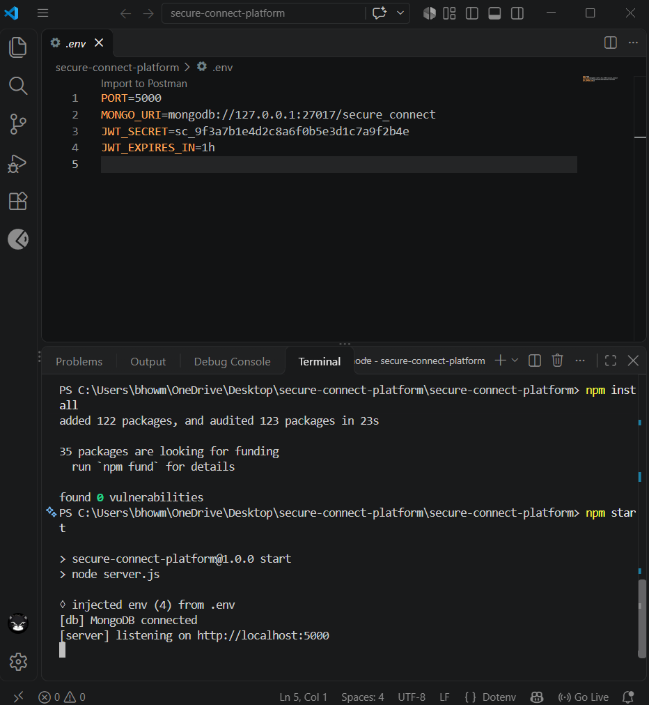
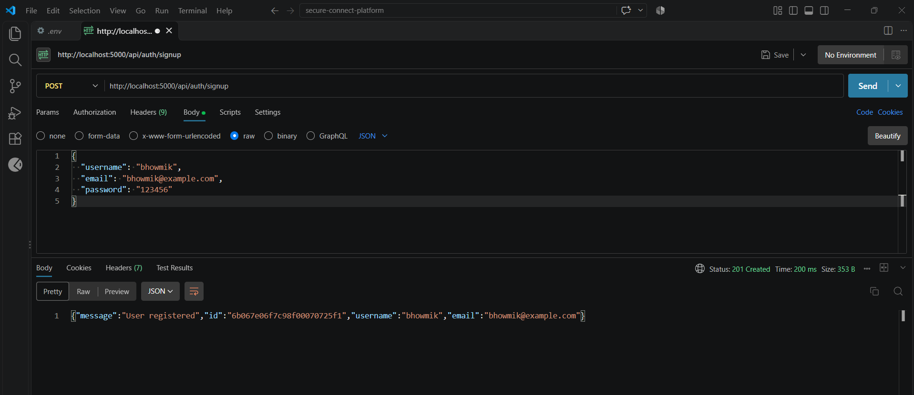
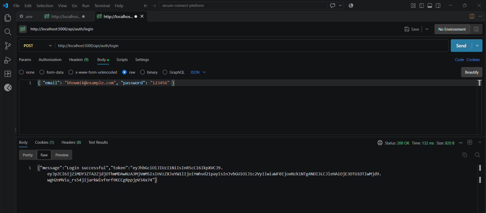
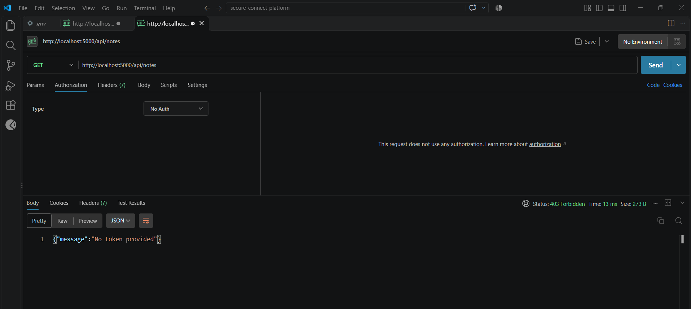
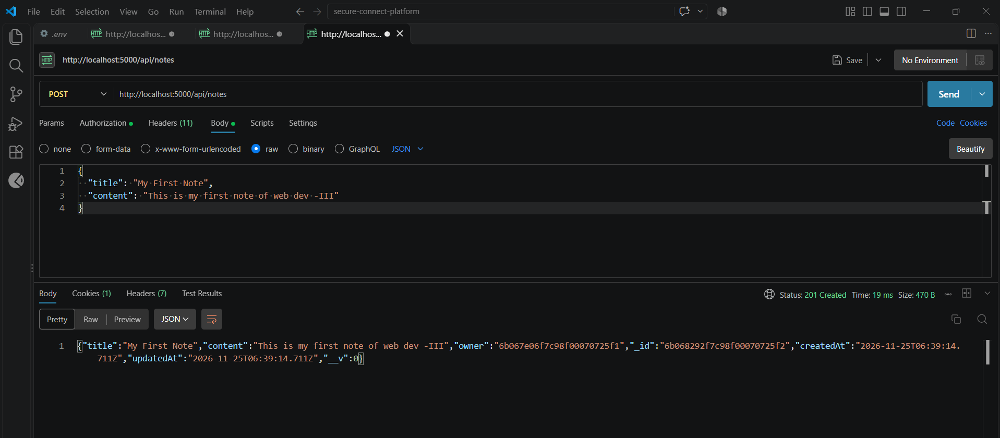
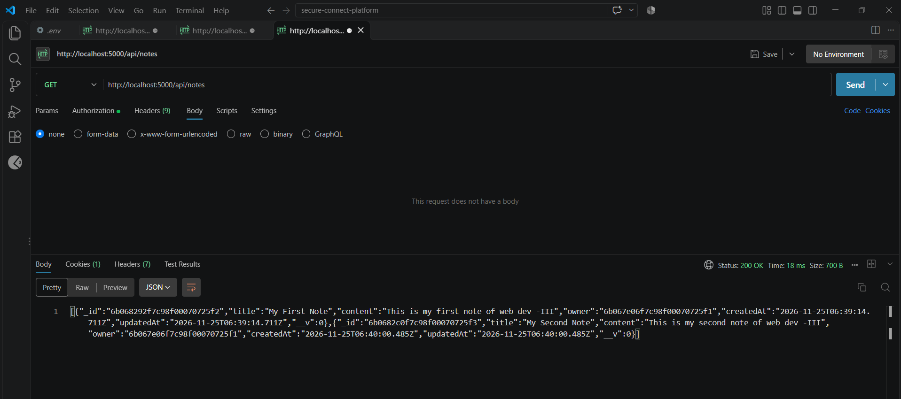
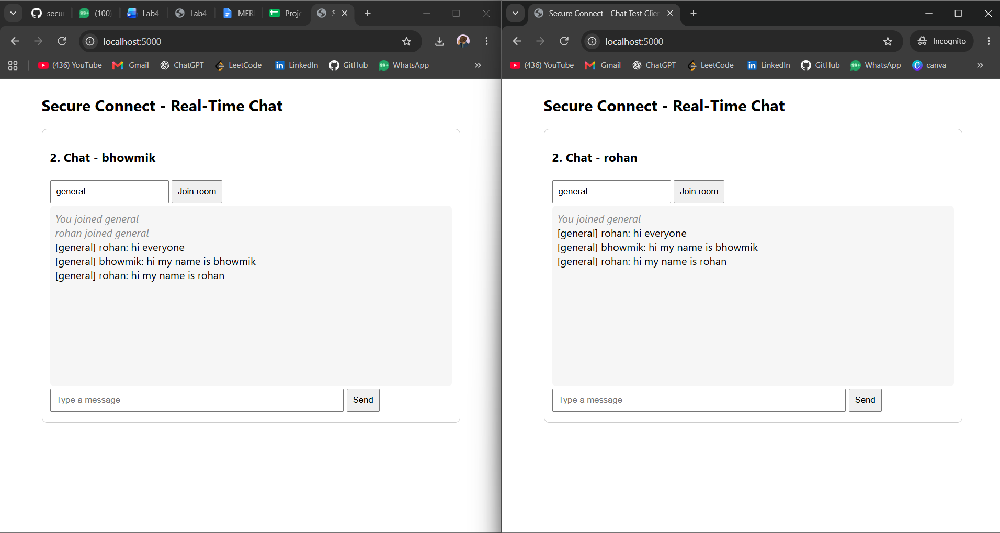

# Secure Connect and Communication Platform

**Course:** Web Dev III (Node.js and Express Backend) | **Lab:** 4 | **Unit:** 4
**Name:** Bhowmik Vij
**Roll No.:** 2501010195

A secure backend built with Node.js and Express. Users can sign up, log in, access protected routes, manage personal notes, and chat in real time. It uses no pre-built authentication boilerplate or starter kits.

## Features

| Module | What it does |
|---|---|
| Signup and Login | Registers users and verifies credentials. Passwords are hashed with **bcrypt** (10 salt rounds). |
| JWT Authentication | Login returns a signed JWT (also set as an httpOnly cookie). It is accepted from the `Authorization: Bearer` header or the `token` cookie. |
| Protected Routes | The `verifyToken` middleware returns `403 No token provided` or `401 Invalid or expired token`. |
| RBAC | The `authorizeRoles('admin')` middleware protects the `/api/admin/*` routes. New users always get the `user` role. |
| Secure Notes API | Full CRUD. Each user can only access their own notes (ownership is checked on every query). |
| Real-Time Chat | **Socket.IO** with rooms. The socket handshake requires a valid JWT. Messages are saved in MongoDB. |
| Event-Driven Features | A shared Node.js **EventEmitter** emits and logs events for signup, login, notes and chat. |
| Environment Variables | Secrets and config are loaded with **dotenv**. |

## Tech Stack
Node.js, Express.js, MongoDB (Mongoose), jsonwebtoken, bcrypt, dotenv, Socket.IO

## Project Structure
```
secure-connect-platform/
├── server.js                 # App entry: Express + HTTP server + Socket.IO
├── .env.example              # Environment variable template
├── public/index.html         # Simple chat client used to test Socket.IO
├── scripts/makeAdmin.js      # Promote a user to admin
└── src/
    ├── config/db.js          # MongoDB connection
    ├── models/               # User, Note, Message
    ├── middleware/auth.js    # verifyToken, authorizeRoles
    ├── routes/               # auth, notes, admin, chat
    ├── events/               # EventEmitter instance + listeners
    └── socket/chat.js        # Socket.IO auth and chat handlers
```

## Setup and Run
1. Install and start MongoDB (or use a MongoDB Atlas URI).
2. Install dependencies:
   ```bash
   npm install
   ```
3. Copy `.env.example` to `.env` and fill in the values:
   ```
   PORT=5000
   MONGO_URI=mongodb://127.0.0.1:27017/secure_connect
   JWT_SECRET=your_long_random_secret
   JWT_EXPIRES_IN=1h
   ```
4. Start the server:
   ```bash
   npm start
   ```
   The server runs on `http://localhost:5000`. Open this URL in a browser to use the chat client.

## API Endpoints

| Method | Route | Access | Description |
|---|---|---|---|
| POST | `/api/auth/signup` | Public | Register a new user |
| POST | `/api/auth/login` | Public | Log in, returns a JWT |
| POST | `/api/auth/logout` | Public | Clears the token cookie |
| GET | `/api/auth/me` | Token | Current user profile |
| POST | `/api/notes` | Token | Create a note |
| GET | `/api/notes` | Token | List my notes |
| GET | `/api/notes/:id` | Token (owner) | Get one note |
| PUT | `/api/notes/:id` | Token (owner) | Update a note |
| DELETE | `/api/notes/:id` | Token (owner) | Delete a note |
| GET | `/api/admin/users` | Admin only | List all users |
| GET | `/api/admin/notes` | Admin only | List all notes |
| GET | `/api/chat/:room/history` | Token | Last 50 messages of a room |

## Socket.IO Events
- **Client to server:** `joinRoom(room)`, `chatMessage({ room, text })`
- **Server to client:** `history`, `chatMessage`, `systemMessage`, `errorMessage`
- A socket connection is rejected if no valid JWT is sent in `auth: { token }`.

## EventEmitter Events
`user:registered`, `user:login`, `note:created`, `note:deleted`, `chat:connected`, `chat:joined`, `chat:message`, `chat:disconnected`

## Screenshots

### 1. Server running and MongoDB connected


### 2. Signup (`201 Created`)


### 3. Login (`200 OK`, JWT returned)


### 4. Notes API blocked without a token (`403 Forbidden`)


### 5. Create a note with a valid JWT (`201 Created`)


### 6. Get all notes with a valid JWT (`200 OK`)


### 7. Real-time chat between two users (Socket.IO)


### 8. Server console: real-time chat and event logs


## Security Notes
- Passwords are never stored in plain text (bcrypt hashes only).
- JWT secret and the database URI are kept in `.env`, which is excluded from Git.
- Users can only read, update or delete their own notes.
- The role cannot be set through signup, so admin access has to be granted separately.
